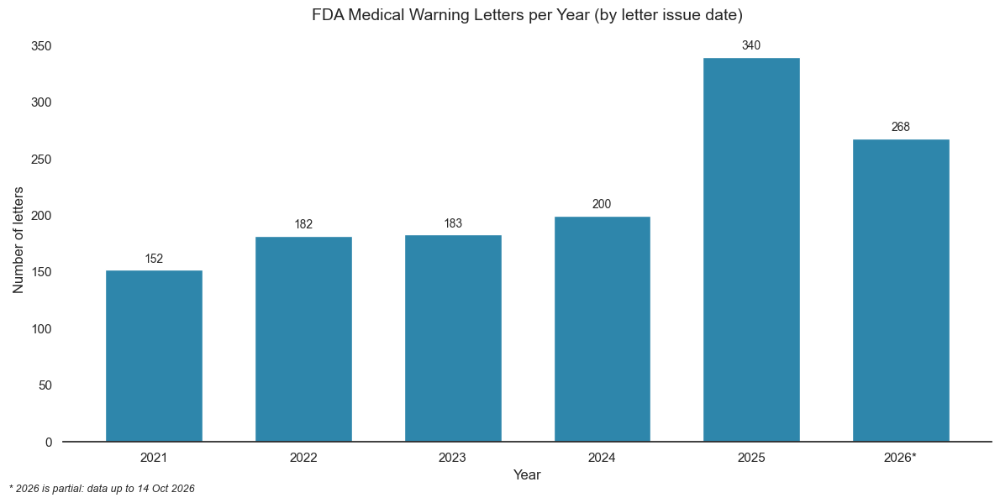
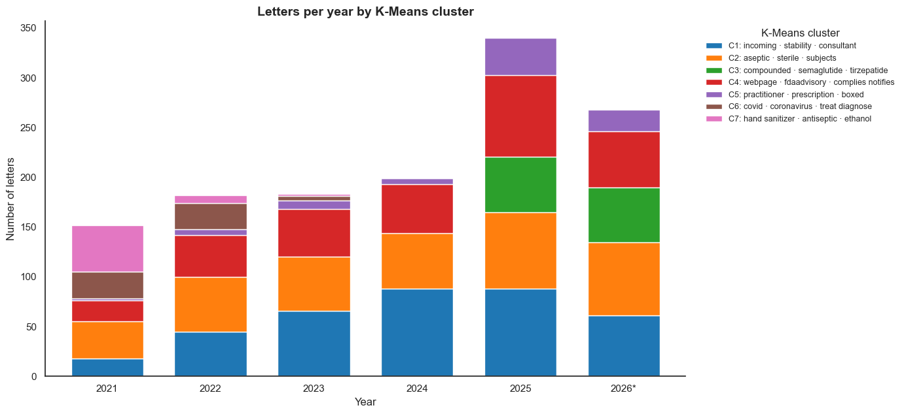
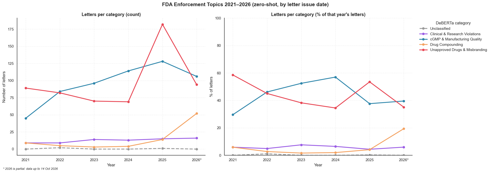

# FDA Warning Letters Analysis Project

NLP analysis of FDA warning letters about drugs and biologics, 2021–2026: **what does the FDA warn companies about, and how has that changed over time?**

The main notebook is [`FDA_Final_fixed.ipynb`](FDA_Final_fixed.ipynb). It scrapes the letters from the FDA website, cleans them, and analyzes them with classic text mining (TF-IDF, K-Means), language-model embeddings (Sentence-BERT + hierarchical clustering) and a zero-shot classifier (DeBERTa).

## Abstract

We collected the full FDA warning-letter table (3,768 letters) and kept the **1,325 letters issued by drug and biologics offices** (CDER, CBER, Pharmaceutical Quality Operations, Biological Products Operations) between January 2021 and October 2026. Each letter was dated by its official issue date and analyzed with three independent methods.

The number of medical warning letters grew from 152 in 2021 to 200 in 2024, and then jumped to **340 in 2025**. About 80% of that jump came from letters about **unapproved drugs and misleading online sales**, driven by a new wave of letters about **compounded semaglutide and tirzepatide** (GLP-1 weight-loss drugs) sold through telehealth websites, a topic that did not exist before 2025. Earlier years show a clear COVID-19 wave (hand sanitizers and unapproved COVID products in 2021–2022), followed by a period in which manufacturing-quality (cGMP) letters were the largest share.

## Repository structure

| Path | Content |
|---|---|
| `FDA_Final_fixed.ipynb` | Main notebook (with all outputs) |
| `data/` | Scraped data and results (see below) |
| `figures/` | Key charts from the notebook |
| `previous_versions/` | Earlier versions of the notebook and the original Excel file |

Files in `data/`:

| File | Content |
|---|---|
| `all_warning_letters_index.csv` | The full FDA table: URL, company, posted and issue dates, issuing office, subject |
| `issuing_offices.csv` | Every issuing office, its number of letters, and whether it is included as "medical" |
| `medical_warning_letters.jsonl` | Full text of the 1,325 medical letters |
| `letters_classified.csv` | Letters with their DeBERTa category (cache of the slowest step) |
| `fda_letters_results.csv` | One row per letter with all results: date, office, subject, clusters, category |
| `manual_check.csv` | 40 random letters for manual validation of the classifier |

## Methods

1. **Data collection.** The FDA warning-letter page is backed by a datatables API. We read the full table (with the official issue date and subject line of every letter) and downloaded the text of every medical letter.
2. **Definition of "medical".** A letter is medical if it was issued by a drug or biologics office. The rule was checked against all 127 issuing offices in the table (`data/issuing_offices.csv`). Device, food, tobacco, veterinary and import offices are excluded.
3. **Preprocessing.** We extract only the body of each letter (from the greeting to the page footer) and remove an extended list of legal and regulatory boilerplate words.
4. **Dominant terms (TF-IDF).** Unigrams, bigrams and trigrams, each concept counted once. Shown both without any manual filter and with a clinical/microbiological filter.
5. **Topic clustering (K-Means).** TF-IDF vectors clustered with K-Means. The number of clusters is chosen by the **Silhouette score** (k = 2…8). Cluster names are generated automatically from each cluster's most distinctive terms, and checked against the FDA subject lines of the letters in the cluster.
6. **Semantic clustering (Sentence-BERT).** Each letter is split into 150-word chunks, so the model reads the whole letter and not only its first 256 tokens. Each chunk is embedded with `all-MiniLM-L6-v2`, and the letter vector is the average of its chunks. The vectors are clustered with Ward hierarchical clustering (k chosen by Silhouette) and visualized with t-SNE and a dendrogram.
7. **Zero-shot classification (DeBERTa).** `DeBERTa-v3-base-mnli-fever-anli` classifies up to 8 chunks of each letter into 4 categories based on the FDA's own subject lines: cGMP & manufacturing quality, unapproved drugs & misbranding, drug compounding, and clinical & research violations. The letter's category is decided by a vote over its chunks.
8. **Validation.** The classifier is compared with a reference label derived from the official FDA subject line. The two clustering methods are cross-tabulated against each other and against the classifier.
9. **Trends.** Letters per year and category, shown both as counts and as **percentages of that year's letters**, so that years with more letters overall don't look like a change in priorities.

## Key results

| Year | 2021 | 2022 | 2023 | 2024 | 2025 | 2026* |
|---|---|---|---|---|---|---|
| Medical warning letters | 152 | 182 | 183 | 200 | 340 | 268 |

\* 2026 is partial: letters up to 14 October 2026.

**What drove the 2025 jump.** Compared with 2024, there were 140 more letters in 2025. 113 of them were classified as unapproved drugs & misbranding. By K-Means cluster, the largest increase came from a new cluster about **compounded semaglutide and tirzepatide** (0 letters in 2021–2024, 56 in 2025, 55 in 2026 so far), followed by online sales of unapproved drugs (+33) and prescription-only drugs sold online (+31).

**Enforcement trends.**

* **2021:** unapproved drugs & misbranding were 59% of the letters, driven by the COVID-19 wave (hand sanitizers and unapproved COVID-19 products).
* **2022–2024:** the share of cGMP & manufacturing-quality letters grew from 30% to 57%, and it became the largest category.
* **2025:** unapproved drugs & misbranding went back up to 54%, driven by GLP-1 drugs sold online.
* **2026 (partial):** drug compounding rose to 19% of the letters. This is the least accurate category (see below), so this rise should be treated with caution.

**Topics found by the clustering methods.**

* **K-Means** (k = 7) found: cGMP manufacturing (366 letters), sterile / aseptic processing and compounding (353), unapproved drugs sold online (298), compounded semaglutide & tirzepatide (111), prescription-only drugs sold online (82), hand sanitizers (58) and COVID-19 products (57).
* **Sentence-BERT** (k = 2) split the letters into two main families: manufacturing and quality (817 letters) versus marketing of unapproved drugs (508). The two methods agree: almost every K-Means cluster falls into a single semantic cluster.
* **Most dominant clinical terms:** contamination, semaglutide, stability, microbiological, sterile, sanitizer, tirzepatide, aseptic.

**Classifier accuracy.** DeBERTa agreed with the FDA subject line on **88.9%** of the 1,192 letters that have a reference label (F1: clinical 0.99, cGMP 0.93, unapproved drugs 0.90, **compounding 0.41**).

## Limitations

* **"Medical"** is our own definition, based on the issuing office.
* **The reference label** for the classifier is derived from the FDA subject line with keyword rules, so it is approximate. A manual check of 40 letters is prepared in `data/manual_check.csv`.
* **Silhouette scores are low** (0.135 for K-Means, 0.19 for the hierarchical clustering), so the clusters overlap and should be read as themes, not sharp categories.
* **Compounding is the weakest category** of the classifier.
* **2026 is a partial year.**

## How to run

1. Open `FDA_Final_fixed.ipynb` in Google Colab (GPU runtime recommended) or in Jupyter.
2. Run all cells. If the files in `data/` are present, the downloads and the classification are loaded from them instead of being repeated. Set `SAVE_TO_DRIVE = True` in Colab to keep the files in Google Drive.

Main libraries: `requests`, `beautifulsoup4`, `pandas`, `scikit-learn`, `scipy`, `matplotlib`, `seaborn`, `torch`, `sentence-transformers`, `transformers`.
